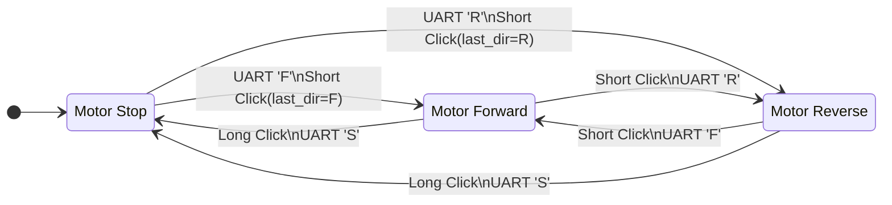

# 상태머신 기반 이송 장비 DC 모터 제어 시스템
[자세한 구현 내용은 Notion 문서를 참고하세요.](https://blushing-addition-5ca.notion.site/v3-0-3a51d46c18fc80859512f7798826be27?pvs=74)

## STM32F411RE DC Motor Control Project

## 1. 프로젝트 개요

본 프로젝트는 STM32F411RE 보드에서 다음 기능을 수행하는 DC 모터 제어 시스템이다.

- DC 모터 정회전
- DC 모터 역회전
- DC 모터 정지
- PWM 듀티비를 이용한 속도 제어
- 사용자 버튼의 숏클릭 및 롱클릭 처리
- UART 명령을 이용한 모터 상태 및 속도 제어
- 상태 머신 기반 모터 제어
- 타이머 인터럽트를 이용한 시간 측정

---

# 2. 사용 MCU 및 주변장치

| 구분 | 사용 장치 | 용도 |
| --- | --- | --- |
| MCU | STM32F411RE | 전체 시스템 제어 |
| GPIOA | PA0, PA1 | 모터 드라이버 방향 및 PWM 출력 |
| GPIOA | PA2, PA3 | USART2 TX/RX |
| GPIOC | PC13 | 사용자 버튼 입력 |
| TIM2 | General Purpose Timer | 버튼 롱클릭 시간 측정 |
| TIM4 | General Purpose Timer | 1ms 시스템 틱 생성 |
| TIM5 | General Purpose Timer | 모터 PWM 출력 |
| USART2 | UART 통신 장치 | PC와 명령 및 상태 메시지 송수신 |
| RCC | Reset and Clock Control | GPIO, Timer, UART 클럭 활성화 |
| NVIC | Interrupt Controller | Timer 및 UART 인터럽트 관리 |
| FLASH | Flash Controller | 시스템 클럭에 맞는 Flash 접근 설정 |
| SCB | System Control Block | FPU 활성화 |

---

# 3. 사용 핀

| 핀 | 모드 | 연결 장치 | 기능 |
| --- | --- | --- | --- |
| PA0 | Alternate Function / Output | 모터 드라이버 입력 1 | TIM5 CH1 PWM 또는 Low 출력 |
| PA1 | Alternate Function / Output | 모터 드라이버 입력 2 | TIM5 CH2 PWM 또는 Low 출력 |
| PA2 | Alternate Function AF7 | USART2 TX | UART 데이터 송신 |
| PA3 | Alternate Function AF7 | USART2 RX | UART 데이터 수신 |
| PC13 | Input | NUCLEO 사용자 버튼 | 버튼 입력, Active Low |

---
# 4. 파일 구성

| 파일 | 주요 기능 |
| --- | --- |
| `main.c` | 전체 프로그램 흐름, UART 명령 처리, 버튼 이벤트 처리 |
| `motor.c` | 모터 정지, 정회전, 역회전, 상태 적용 |
| `motor.h` | 모터 상태형, 구조체, 함수 선언, 상수 정의 |
| `key.c` | 버튼 입력 및 숏클릭·롱클릭 상태 머신 |
| `key.h` | 버튼 상태형, 이벤트형, 함수 선언 |
| `timer.c` | TIM2, TIM4, TIM5 초기화 및 PWM 설정 |
| `timer.h` | 타이머 상수 및 함수 선언 |
| `clock.c` | PLL 기반 96 MHz 시스템 클럭 설정 |
| `uart.c` | USART1, USART2 초기화 및 송수신 |
| `exception.c` | Timer, UART 인터럽트 서비스 루틴 |
| `device_driver.h` | 공통 드라이버 헤더 및 UART·Clock 함수 선언 |
| `option.h` | 시스템 클럭 및 메모리 관련 상수 |
| `macro.h` | 비트 및 비트 필드 조작 매크로 |
| `crt0.s` | MCU 시작 코드 및 인터럽트 벡터 |
| `runtime.c` | C 런타임 및 표준 입출력 연결 |

---
# 5. 전체 전역 변수 정리

| 변수명 | 자료형 | 선언 파일 | 기능 |
| --- | --- | --- | --- |
| `Sys_Tick` | `volatile unsigned long` | `timer.c` | 1ms 시스템 시간 |
| `TIM2_Timeout_Flag` | `volatile unsigned char` | `exception.c` | 롱클릭 타임아웃 플래그 |
| `Uart_Data_In` | `volatile int` | `uart.c` | UART 수신 완료 여부 |
| `Uart_Data` | `volatile unsigned char` | `uart.c` | 수신 UART 문자 |
| `key_event_funcs` | 함수 포인터 배열 | `main.c` | 버튼 이벤트별 처리 함수 연결 |

---

# 21. 전체 함수 정리

| 함수명 | 반환형 | 인자 | 파일 | 기능 |
| --- | --- | --- | --- | --- |
| `Main` | `void` | 없음 | `main.c` | 메인 프로그램 |
| `Sys_Init` | `void` | `int baud` | `main.c` | 시스템 초기화 |
| `On_Uart_Input` | `void` | `MotorController *`, `char` | `main.c` | UART 명령 처리 |
| `On_Short_Click` | `void` | `MotorController *` | `main.c` | 숏클릭 처리 |
| `On_Long_Click` | `void` | `MotorController *` | `main.c` | 롱클릭 처리 |
| `Motor_Init` | `void` | 없음 | `motor.c` | 모터 GPIO 초기화 |
| `Motor_Stop` | `void` | 없음 | `motor.c` | 모터 정지 |
| `Motor_Forward` | `void` | `int duty` | `motor.c` | 정회전 |
| `Motor_Reverse` | `void` | `int duty` | `motor.c` | 역회전 |
| `Motor_Update` | `void` | `const MotorController *` | `motor.c` | 상태 적용 |
| `Key_Init` | `void` | 없음 | `key.c` | 버튼 GPIO 초기화 |
| `Key_Is_Pressed` | `int` | 없음 | `key.c` | 버튼 상태 반환 |
| `Key_Get_Event` | `KeyEvent` | 없음 | `key.c` | 버튼 이벤트 반환 |
| `Timer_Init` | `void` | 없음 | `timer.c` | Timer 전체 초기화 |
| `TIM2_Init` | `void` | 없음 | `timer.c` | 롱클릭 Timer 초기화 |
| `TIM2_Start` | `void` | `int delay_ms` | `timer.c` | 원샷 Timer 시작 |
| `TIM2_Stop` | `void` | 없음 | `timer.c` | 원샷 Timer 정지 |
| `TIM4_Init` | `void` | 없음 | `timer.c` | 1ms Tick Timer 초기화 |
| `TIM5_Init` | `void` | 없음 | `timer.c` | PWM Timer 초기화 |
| `TIM5_Set_Duty` | `void` | `int`, `int` | `timer.c` | PWM Duty 설정 |
| `Clock_Init` | `void` | 없음 | `clock.c` | 시스템 클럭 설정 |
| `Uart2_Init` | `void` | `int baud` | `uart.c` | USART2 초기화 |
| `Uart2_Send_Byte` | `void` | `char` | `uart.c` | UART 문자 송신 |
| `Uart2_Receive_Byte` | `char` | 없음 | `uart.c` | Blocking 수신 |
| `Uart2_Read_Byte` | `char` | 없음 | `uart.c` | Non-Blocking 수신 |
| `Uart2_RX_Interrupt_Enable` | `void` | `int` | `uart.c` | RX 인터럽트 제어 |
| `TIM2_IRQHandler` | `void` | 없음 | `exception.c` | TIM2 ISR |
| `TIM4_IRQHandler` | `void` | 없음 | `exception.c` | TIM4 ISR |
| `USART2_IRQHandler` | `void` | 없음 | `exception.c` | USART2 RX ISR |

---

# 6. 전체 레지스터 정리

| 주변장치 | 레지스터 | 기능 |
| --- | --- | --- |
| RCC | `RCC->CR` | HSI 및 PLL 활성화 |
| RCC | `RCC->PLLCFGR` | PLL 설정 |
| RCC | `RCC->CFGR` | 시스템 및 버스 클럭 설정 |
| RCC | `RCC->AHB1ENR` | GPIOA, GPIOC 클럭 활성화 |
| RCC | `RCC->APB1ENR` | TIM2, TIM4, TIM5, USART2 클럭 활성화 |
| GPIOA | `GPIOA->MODER` | PA0~PA3 모드 설정 |
| GPIOA | `GPIOA->ODR` | PA0, PA1 출력값 설정 |
| GPIOA | `GPIOA->AFR[0]` | PA0, PA1 TIM5 및 PA2, PA3 USART2 설정 |
| GPIOA | `GPIOA->PUPDR` | USART 핀 Pull-Up |
| GPIOA | `GPIOA->LCKR` | PA2, PA3 설정 Lock |
| GPIOC | `GPIOC->MODER` | PC13 입력 모드 |
| GPIOC | `GPIOC->IDR` | PC13 버튼 상태 읽기 |
| TIM2 | `TIM2->CR1` | Timer 동작 모드 및 시작 |
| TIM2 | `TIM2->PSC` | Prescaler |
| TIM2 | `TIM2->ARR` | 롱클릭 시간 설정 |
| TIM2 | `TIM2->EGR` | 설정 동기화 |
| TIM2 | `TIM2->SR` | Update Flag |
| TIM2 | `TIM2->DIER` | 인터럽트 활성화 |
| TIM4 | `TIM4->CR1` | 1ms Tick Timer 시작 |
| TIM4 | `TIM4->PSC` | Prescaler |
| TIM4 | `TIM4->ARR` | 1ms 주기 |
| TIM4 | `TIM4->SR` | Update Flag |
| TIM4 | `TIM4->DIER` | 인터럽트 활성화 |
| TIM5 | `TIM5->CR1` | PWM Timer 시작 |
| TIM5 | `TIM5->PSC` | PWM Counter Clock 설정 |
| TIM5 | `TIM5->ARR` | PWM Period |
| TIM5 | `TIM5->CCMR1` | PWM Mode 설정 |
| TIM5 | `TIM5->CCER` | CH1, CH2 출력 활성화 |
| TIM5 | `TIM5->CCR1` | CH1 Duty |
| TIM5 | `TIM5->CCR2` | CH2 Duty |
| USART2 | `USART2->BRR` | Baud Rate |
| USART2 | `USART2->CR1` | USART 및 TX/RX 활성화 |
| USART2 | `USART2->CR2` | Stop Bit |
| USART2 | `USART2->CR3` | 추가 통신 설정 |
| USART2 | `USART2->SR` | 통신 상태 |
| USART2 | `USART2->DR` | 데이터 송수신 |
| FLASH | `FLASH->ACR` | Flash Latency 및 Cache |
| SCB | `SCB->CPACR` | FPU 활성화 |
| SCB | `SCB->ICSR` | 현재 예외 번호 확인 |

---

# 7. 전체 동작 흐름
전원 인가

↓

crt0.s 실행

↓

Main() 호출

↓

96MHz 시스템 클럭 설정

↓

USART2 115200bps 설정

↓

TIM2 롱클릭 Timer 설정

↓

TIM4 1ms Tick Timer 설정

↓

TIM5 20kHz PWM 설정

↓

PC13 버튼 Input 설정

↓

PA0, PA1 모터 제어핀 설정

↓

USART2 RX 인터럽트 활성화

↓

모터 STOP 상태 적용

↓

무한 반복
├─ UART 명령 확인
├─ 버튼 상태 머신 실행
├─ 숏클릭 시 방향 변경
├─ 롱클릭 시 정지
└─ UART 명령에 따라 상태 및 속도 변경
